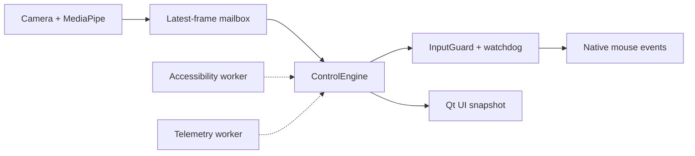
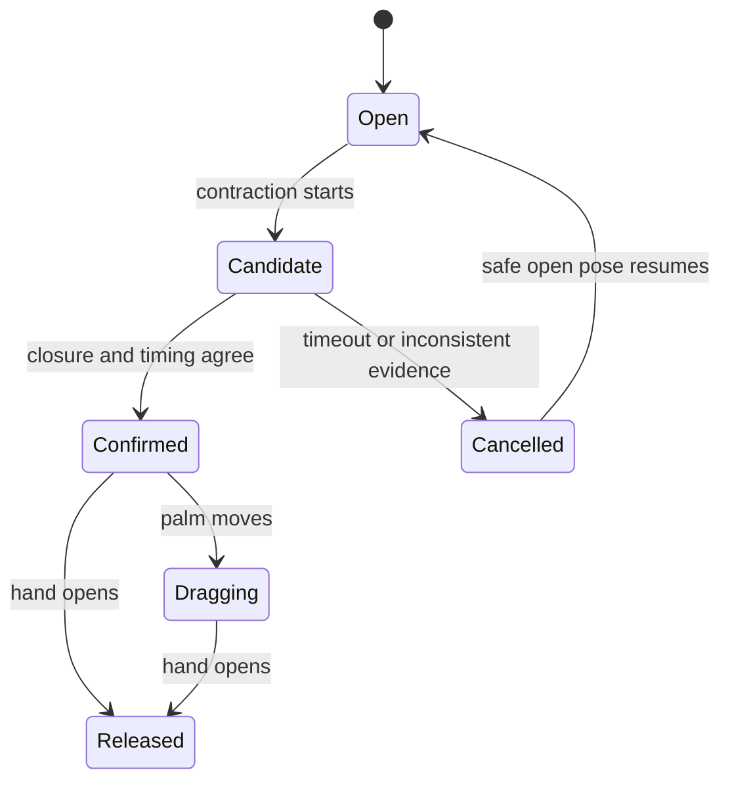
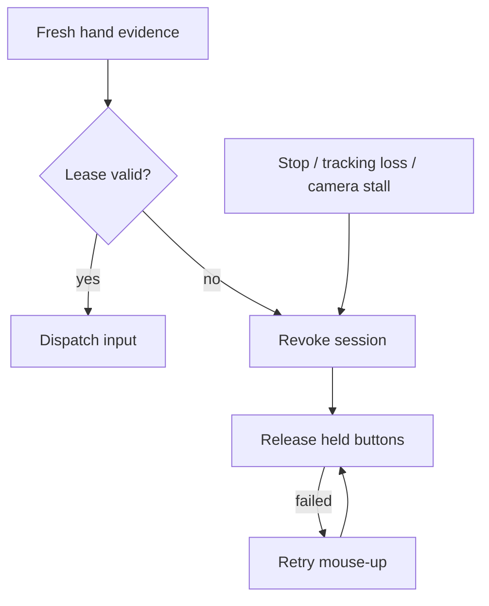

# PinchCursor

[English](README.md) | [简体中文](README.zh-CN.md)

**Control a Mac with continuous hand gestures.** PinchCursor turns webcam hand tracking into pointer movement, clicks, dragging and scrolling, while keeping intent decisions deterministic, local and interruptible.

Related search terms: webcam mouse, virtual mouse, touchless mouse, air mouse, hand gesture mouse, pinch-to-click and MediaPipe hand tracking.

<p align="center">
  
</p>

<p align="center">
  
  
  
  
  
</p>

<p align="center">
  
</p>

## What it does

| | |
|---|---|
| **Pointer** | Move, click, double-click, drag and scroll with 21 tracked hand landmarks |
| **Intent** | Combine open pointing, contraction, closure timing and release into one continuous pinch episode |
| **Aiming** | Reconstruct the pre-closure target so moving fingers do not pull the click away from the intended point |
| **Safety** | Release held buttons on opening, tracking loss, stale frames, camera stalls and app stop |
| **Control** | Absolute or relative mapping, multi-display support, fine control, calibration and custom gestures |
| **Privacy** | Frames stay in memory; optional diagnostics are bounded, local and off by default |

## How it works



Camera processing and MediaPipe inference run away from the UI. A single control thread owns filtering, intent, pointer state and native dispatch. Accessibility and telemetry are optional background services with bounded queues, so slow context lookup or disk writes cannot block pointer movement.

## Continuous intent



While a pinch is only a candidate, the visible pointer keeps following the fingertip and a separate branch stores the reconstructed aim. Confirmation locks that aim before applying the click. Dragging then uses palm motion, so finger curl cannot drift the click or start a drag by itself.

## Failure safety



The watchdog uses a 250 ms evidence lease and retries failed releases. A late frame cannot renew a revoked session, and a pending mouse-up blocks another press. These are software guarantees; an OS call that blocks inside the native API still requires physical acceptance testing.

## Install

Requires macOS 15+, Python 3.13 and a camera.

```bash
git clone https://github.com/CYK16688/PinchCursor.git
cd PinchCursor
python3.13 -m venv .venv
.venv/bin/pip install -r requirements.txt
.venv/bin/python main.py
```

Runtime state lives in `~/Library/Application Support/PinchCursor/`, never inside the app bundle.

Build and launch the app:

```bash
./scripts/build_macos_app.sh
open "dist/PinchCursor.app"
```

Grant **Camera** and **Accessibility** in **System Settings → Privacy & Security**. Add **Input Monitoring** only if you use the hold-to-activate shortcut. A stable `Developer ID Application` signature keeps those grants across rebuilds; the build falls back to ad-hoc signing when no certificate is available.

## Use it

1. Select a camera and activation mode in **Settings**.
2. Press **Start**, show an open palm, move your hand and pinch to click.
3. Open your hand to release, or close a fist to end the session.
4. Run **Settings → Control → Calibrate pinch** once for your own hand and camera distance.

<p align="center">
  
</p>

## Privacy and learning

Camera frames never leave memory. The optional event log stores gesture outcomes and geometry without images, text or window titles; it is capped and disabled by default.

Pinch calibration, recorded gestures and optional target ranking adapt locally. The only model allowed to affect pointer input is the target ranker, and it starts in shadow mode until explicitly promoted. See [the runtime contract](docs/CONTROL_ARCHITECTURE.md) for thresholds and rollback behavior.

## Validation

```bash
env -u PYTHONPATH QT_QPA_PLATFORM=offscreen .venv/bin/python -m pytest -q
# 1353 passed
```

Synthetic landmark replays cover click, double-click, drag, release, scroll, tracking loss, stale frames, camera geometry changes, fine control and 15/30/60 FPS paths. Native input uses fake OS sinks. Real-camera accuracy, physical mouse equivalence, actual unplug recovery and long-session comfort still require device acceptance; details are in [VALIDATION.md](docs/VALIDATION.md).

## Ecosystem and related projects

PinchCursor is a macOS-specific implementation focused on continuous pinch intent, pre-closure click targeting and watchdog-protected native input. These projects are useful dependencies, prior art or indexes; a reference does not imply compatibility, endorsement or equivalent behavior.

| Project | Relationship |
|---|---|
| [MediaPipe](https://github.com/google-ai-edge/mediapipe) · ~37.4k stars | Hand landmark inference used by the runtime |
| [OpenCV](https://github.com/opencv/opencv) · ~91.4k stars | Camera and image-processing foundation |
| [PyObjC](https://github.com/ronaldoussoren/pyobjc) · ~827 stars | macOS accessibility and native event bridge |
| [Barehands](https://github.com/jaredrhod/barehands) · ~1.1k stars | Adjacent webcam hand-controlled interface |
| [Gesture-Controlled-Virtual-Mouse](https://github.com/Viral-Doshi/Gesture-Controlled-Virtual-Mouse) · ~878 stars | Popular Python/MediaPipe virtual-mouse baseline |
| [hand-gesture-recognition-using-mediapipe](https://github.com/Kazuhito00/hand-gesture-recognition-using-mediapipe) · ~770 stars | Hand-landmark gesture-classification reference |
| [awesome-hands-control](https://github.com/RylanBot/awesome-hands-control) · ~350 stars | Curated index of hand-controlled software |
| [NonMouse](https://github.com/takeyamayuki/NonMouse) · ~202 stars | Desk-oriented webcam gesture mouse |

Star counts are approximate and were checked on 2026-10-29.

## Status

- macOS is supported; the Windows adapter is experimental.
- Accessibility aiming works best with native controls and may not engage in Electron or web content.
- The learned target ranker needs several hundred labelled clicks before it is useful.

## License

AGPL-3.0. See [LICENSE](LICENSE).

Built with [MediaPipe](https://developers.google.com/edge/mediapipe/solutions/vision/hand_landmarker) and [PySide6](https://doc.qt.io/qtforpython/).
