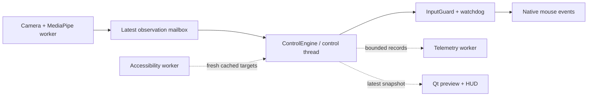

# PinchCursor

**Turn your Mac into a touchless workstation.** PinchCursor reads your hand from the built‑in camera and drives the pointer — move, click, drag, scroll, run shortcuts — while keeping every decision deterministic, local, and reversible.

<p align="center">
  
</p>

<p align="center">
  
  
  
  
  
</p>

<p align="center">
  
</p>

> **中文简介** — PinchCursor 是一套 macOS 手势输入系统：摄像头识别 21 个手部关键点，用确定性的状态机驱动指针、点击、拖动与滚动。它的重点不是"炫技"，而是把延迟、误触、隐私和可回退性当成第一等公民：核心指针通道永远由状态机独占，机器学习只做建议，全部数据留在本机。

---

## Why another gesture app?

Most gesture demos die at the same three places: the cursor jitters, a fist closing to an exit gesture fires a phantom click, and nobody can tell whether the thing is learning anything. PinchCursor is built around those failures instead of around the demo:

- **Deterministic pointer lane.** Move / click / drag are owned by a state machine. A learned model may *rank candidates*, never emit input.
- **Transition guards.** A fist closes *through* the pinch shape; a causal 200 ms motion window tells a real pinch from a pass‑through, so the click never fires on the way out.
- **Target‑aware clicks.** At the moment you pinch, the accessibility tree supplies the buttons around your cursor; a Bayesian scorer snaps the 24 px you were off — and refuses when two candidates are equally likely.
- **Feels like a tool, not a toy.** Two resource profiles, a local event log with a hard size ceiling, per‑user pinch calibration, and a full revert path for every feature.

## Features

| | |
|---|---|
| **Pointer control** | 21‑landmark hand tracking → cursor movement, left/right/double click, drag, four‑way scroll, custom shortcuts (13 native actions on macOS) |
| **Two mapping modes** | *Absolute* (hand position = screen position) or *relative* with a gain and automatic re‑anchoring — relative mode needs half the arm travel |
| **Multi‑display aware** | The pointer maps onto the union of every attached display, including displays with negative origins |
| **Aiming assist** | Bayesian target scoring from the accessibility tree; 24 px snap ceiling, ambiguity rejection, optional learned ranker |
| **Gesture grammar** | Static poses with hysteresis, user‑recorded dynamic motions (DTW with a trajectory channel), two‑stage combos, custom trigger poses |
| **Context‑aware** | Gestures and actions can be gated by the accessibility category under the pointer (clickable, slider, text input, scrollable) |
| **Two performance profiles** | *Standard*: 640×480 on CPU. *Performance*: 1280×720 on the Metal GPU — measured **faster per frame** than standard |
| **Privacy first** | Camera frames never leave memory. The optional event log stores geometry and outcomes only — no images, no text, no window titles — capped at ~2 MB and 30 days |
| **Bilingual UI** | Full Chinese and English catalogues, switchable at runtime |

## How it works



Camera capture and MediaPipe inference submit directly to a dedicated control thread through a single-slot mailbox. `ControlEngine` owns classification, temporal arbitration and action lifecycles; the GUI only renders snapshots. An independent input watchdog expires camera evidence after 250 ms and attempts to release held buttons even when the GUI stops processing events. Native dispatch and release are serialized. Stop revokes the session before waiting for workers, so an in-flight frame cannot restart input. Accessibility and telemetry have bounded background queues; neither blocks the control thread. See [the runtime contract](docs/CONTROL_ARCHITECTURE.md).

Click admission and targeting use the same continuous episode: qualified open pointing, contraction, confirmed closure and release. The pre-closure fingertip is transported with the palm, and a short numeric filter history reconstructs the aimed trajectory without finger-curl displacement. During an unconfirmed candidate, the visible pointer continues following the fingertip while a separate branch stores the reconstructed target. Confirmation locks that target; separate palm-driven motion controls dragging. Safe open pointing resumes movement after cancellation without prematurely rearming a click. Confirmed opening releases the button; uncertain evidence cancels the interaction. Settled pointing can transition into a held thumb gesture for continuous scrolling, with the aimed position fixed and no dependency on accessibility target discovery. Floating-point observations are preserved until input dispatch, and sustained small corrections can settle through the resting-jitter dead zone.

The decision engine and its runtime are Python modules without Qt imports. The camera worker and GUI shell use PySide6; `platform_services/` hides macOS Accessibility and CGEvent behind contracts with fake implementations for tests.

### Intent, in detail


Motion evidence, activation and lane ownership decide whether input may proceed. Whole-hand closing, isolated pinch flashes and inconsistent tracking cancel a click candidate. In gesture-activation mode, the activation pose must be held before control begins. Target assistance is optional: when no candidate clears its confidence threshold, the reconstructed aim remains the click target.

| Stage | What it reads | What it rejects |
|---|---|---|
| **Track** | smoothed position, time since last sighting | a cursor that jumps while the hand is out of frame |
| **Classify** | 21 landmarks, thumb–index ratio against your calibrated thresholds | hands at a distance where the ratio means nothing |
| **Dynamics** | pinch confidence, closing rate of the other three fingers | the classic false pinch — a whole hand closing |
| **Session gate** | activation gesture held 0.3 s, 2.0 s grace after loss | idle hands resting in view |
| **Arbiter** | which lane held the hand last, neutral for 3 frames | a combo and a pointer gesture claiming the same frame |
| **Joint pinch/aim** | trusted open pose, contraction history, confident closure, palm-transported tip and physical timing | isolated closures, finger-curl target drift, curl-only drag and incomplete episodes |
| **Lanes** | 5 stable frames, DTW distance, 0.3 s dwell | sequences that never completed |
| **Target resolution** | softmax over accessibility candidates, 0.55 floor, 24–60 px snap | ambiguous neighbours and unreachable targets |

Recorded motions are the one lane that is taught rather than inferred: a trajectory is stored as a 65-dimensional sequence, optionally bound to an accessibility category ("only in scrollable areas"), and matched with DTW against your own templates. Ten prototypes over a 180-frame take cost 7.8 ms — once per completed motion, not per frame.

### Measured on an Apple M5 Max

| | Standard (640×480 CPU) | Performance (1280×720 Metal) |
|---|---|---|
| Inference / frame | 5.18 ms | **4.06 ms** |
| Steady‑state CPU | ≈16 % of one core | lower — the work leaves the CPU |
| Target probe (per click) | 3.9 ms | 3.9 ms |
| Dynamic gesture match | 7.8 ms / 10 templates | same |

Numbers are from `time.perf_counter` loops in this repository, not from a spec sheet.

## Install

Requires macOS 15+, Python 3.13, and a camera.

```bash
git clone https://github.com/CYK16688/PinchCursor.git
cd PinchCursor
python3.13 -m venv .venv
.venv/bin/pip install -r requirements.txt
.venv/bin/python main.py
```

Runtime state — `settings.json`, the optional event log and the single‑instance
lock — lives in `~/Library/Application Support/PinchCursor/`, never inside the app
bundle: writing there invalidates the signature of a signed bundle and loses the
settings on the next build. A settings file found at the old in‑bundle location is
moved across on first launch.

Build a standalone `.app` (PyInstaller cannot cross‑compile, so run it on macOS):

```bash
./scripts/build_macos_app.sh
open "dist/PinchCursor.app"
```

The script auto-detects a `Developer ID Application` certificate in the keychain and signs with it. That matters more than it looks: a Developer ID signature pins the app's designated requirement to **bundle ID + Team ID**, so one round of Camera/Accessibility/Input Monitoring grants survives every later rebuild. Without a certificate it falls back to ad-hoc, whose designated requirement is the binary hash — each build then looks like a brand-new app, and macOS does something worse than prompting again: it keeps the old switches switched **on** in System Settings while denying the running app, which is very hard to diagnose from the UI.

```bash
./scripts/build_macos_app.sh                                     # auto-detects
CODESIGN_IDENTITY="Developer ID Application: ..." ./scripts/...   # explicit
```

Either way the app needs three grants, in **System Settings → Privacy & Security**: Camera, Accessibility (move the pointer, post clicks) and Input Monitoring (read the hold-to-activate shortcut). Accessibility and Input Monitoring only take effect after the app is quit and reopened. If a grant was made before a rebuild that changed the signature, reset the stale record instead of re-toggling it — the switch will keep lying until you do: `tccutil reset Accessibility com.cyk16688.pinchcursor` (and `Camera`).

The build ends with a release gate that fails the build rather than shipping a broken bundle: it refuses to finish if any runtime state (`settings.json`, the event log, a lock file) was collected inside `Contents/`, or if `codesign --verify --strict` no longer passes. Either condition means the next launch is refused by Gatekeeper and every TCC grant keyed to the signature is lost.

### Permissions

macOS gates the interesting parts. Grant **Camera** (to see your hand) and **Accessibility** (to move the pointer and read the UI). Input Monitoring is only needed if you use the hold‑to‑activate shortcut. Rebuilding the app with an ad‑hoc signature resets these grants — expect to re‑approve once.

## Using it

1. Pick a camera in **Settings → Camera**.
2. Choose how control activates: a hand gesture (default: open palm), a hold‑to‑talk style shortcut, either, or always.
3. Press **Start**. Show your palm to take control, move, and pinch to click. A fist ends the session.
4. Open **Settings → Control → Calibrate pinch** once; it learns your own pinch amplitude so the threshold survives a new camera or a different seat.
5. Optional: turn on **Usage data** (local only) and later train the candidate ranker with `scripts/train_target_ranker.py` — see below.

<p align="center">
  
</p>

<p align="center">
  
</p>

## Privacy

- Frames live in memory and are overwritten every frame. Nothing is recorded.
- The optional event log (`telemetry.sqlite3`) stores gesture names, accessibility roles, geometry, latency and outcomes. It has no column for text, labels, titles, or images, is capped at 20 000 events / 30 days, and **is off by default**.
- "Delete collected data" in settings vacuums the file, not just the rows.

## Learning loop (optional, local)

**There is no online self-learning, and that is deliberate.** A model that retrains on whatever it just saw will learn the user's mistakes, and nothing that moves the pointer is allowed to run without evidence. What the app does adapt to is narrower, and every piece of it is inspectable:

| Mechanism | Trigger | Persists in | What it changes |
|---|---|---|---|
| **Pinch calibration** | five pinches in settings | `settings.json` | the enter/exit ratio thresholds for your hand and camera distance |
| **Recorded motion** | you record one take | `settings.json` (`dynamic_gestures.templates`) | a DTW prototype, optionally bound to an accessibility category |
| **Target ranker** | `scripts/train_target_ranker.py` over your telemetry | `target_ranker.json` | how candidate targets are scored — never whether a click happens |
| **Aim assist** | every launch, when usage statistics are on | `settings.json` (`pointer_assist.learned`) | the snap radius and confidence floor — bounded, and on evidence |
| **Pinch boundary** | every pinch, when usage statistics are on | `telemetry.sqlite3` (`transitions`), then `transition_model.json` | whether a pinch was intended — **shadow only**, it never decides yet |

The aim assist is the one parameter that tunes itself, from the cheapest honest signal the app already records: clicks you had to redo within 1.5 s. Above a 20 % redo rate it narrows the snap by at most 15 % and raises the confidence floor by at most 0.03; after a clean hundred clicks it relaxes the floor slightly. It never widens the snap past the value you configured, and editing that value discards the learned step — your number wins.

The pinch boundary is the second loop, and it starts from a labelling trick. When the transition guard drops a pinch, no click happens, so there is nothing to learn from — unless the user objects, and the one observable objection is insisting: the pinch is dropped and the hand returns to a pinch within half a second. That retry is the only label that can teach a model to disagree with the rule, so every dropped episode is held for 0.55 s before it is written. `scripts/train_transition.py` fits a logistic boundary over six motion features and refuses to write anything that does not beat the rule on a time-ordered hold-out. Until then the model's score is recorded next to the rule's decision and nothing acts on it.

The ranker is the only learned model that can act, and it runs behind three gates: it refuses to train below 200 labelled locks, it splits by time rather than at random and prints its validation top-1 next to the Bayesian baseline, and it can start in **shadow** mode, where it logs whether it agrees with the deterministic scorer without touching the pointer. Promotion to `ranker` mode is a setting you change, not something the app decides.

```
normal use ─▶ candidates table (features + labels) ─▶ train_target_ranker.py
                                                              │
                      settings: Bayesian ◀── shadow ──▶ learned ranker
```

```bash
.venv/bin/python scripts/train_target_ranker.py --db ~/path/to/telemetry.sqlite3
```

Before training anything, ask the log what it has:

```bash
.venv/bin/python scripts/learning_status.py --db ~/path/to/telemetry.sqlite3
# pinch episodes   42 / 300
#   acted+retried  28 (need 60)
#   dropped        14 (need 60)
# shadow agreement 100.0% over 42 scored episodes
# ready to train   no  — waiting on: episodes, positives, negatives
```

The same two figures appear in Settings → Advanced → Statistics, so you can watch the loop fill up without opening a terminal. `ready to train yes` is the trainer's own gate, not a separate estimate.

<p align="center">
  
</p>

## Tests

```bash
env -u PYTHONPATH QT_QPA_PLATFORM=offscreen .venv/bin/python -m pytest -q
# 1353 passed
```

The suite covers the native adapters with fake bindings, the decision layers with synthetic landmarks, the QSS wiring, and the packaging contracts. macOS input itself is exercised by hand — see `docs/VALIDATION.md`.

## Status & limits

- **macOS is the supported platform.** A Windows adapter exists behind the same contracts but has only been tested with fake bindings; treat it as experimental.
- **Stable mouse replacement is the goal; real-use acceptance is pending.**
  Complete landmark replays now cover clicks, double clicks, moving drags and
  releases at 15/30/60 FPS, continuous scrolling against coordinate-dependent
  targets, tracking loss and stale frames. These tests use fake native input.
  Joint click/aim replays compare against an independent open-finger trajectory,
  including sudden/gradual closing while moving, screen edges, relative mapping,
  rejected-episode recovery and camera geometry changes.
  Synthetic precision tests cover sustained one-point corrections and reaching
  screen edges, but do not establish real-camera accuracy or comfort. End-to-end
  latency, small-target selection, text selection and prolonged use still need
  comparison against a physical mouse. Inference timing alone is not input latency.
- **Accessibility coverage varies.** Native controls expose geometry; Electron and web content often do not, so aiming assist simply does not engage there.
- **The learned ranker is new.** It trains on your own usage; until you have a few hundred labelled locks, the Bayesian scorer is the better answer.

## Topics

`macos` · `gesture-control` · `hand-tracking` · `mediapipe` · `pyside6` · `accessibility` · `computer-vision` · `dtw` · `privacy` · `desktop-automation` · `python` · `human-computer-interaction`

## Roadmap

- [x] Deterministic pointer lane with arbitration and session gating
- [x] Target‑aware snapping with ambiguity rejection
- [x] Relative mapping, multi‑display union, pinch calibration
- [x] Trajectory channel for recorded motions
- [x] Local telemetry + candidate ranker training pipeline
- [ ] Windows hardware validation
- [x] Episode logging, offline trainer and shadow scoring for the pinch boundary
- [ ] Promote the learned boundary once it beats the rule on held-out data
- [ ] On‑device calibration of the motion thresholds from real recordings

## License

AGPL‑3.0. See [LICENSE](LICENSE).

Copyright (C) 2026 CYK16688.

Built on [MediaPipe](https://developers.google.com/edge/mediapipe/solutions/vision/hand_landmarker) hand landmarks and [PySide6](https://doc.qt.io/qtforpython/). The 1€ filter follows Casiez, Roussel & Vogel (CHI 2012); the target scorer follows Bi & Zhai's Bayesian Touch (UIST 2013).
