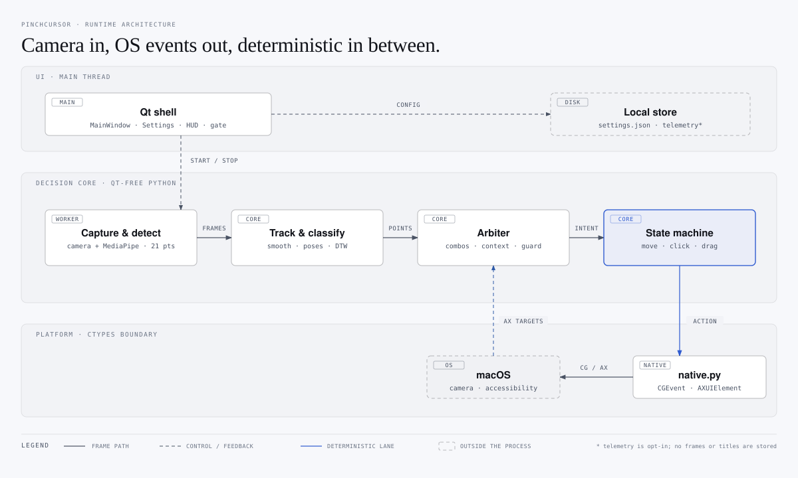
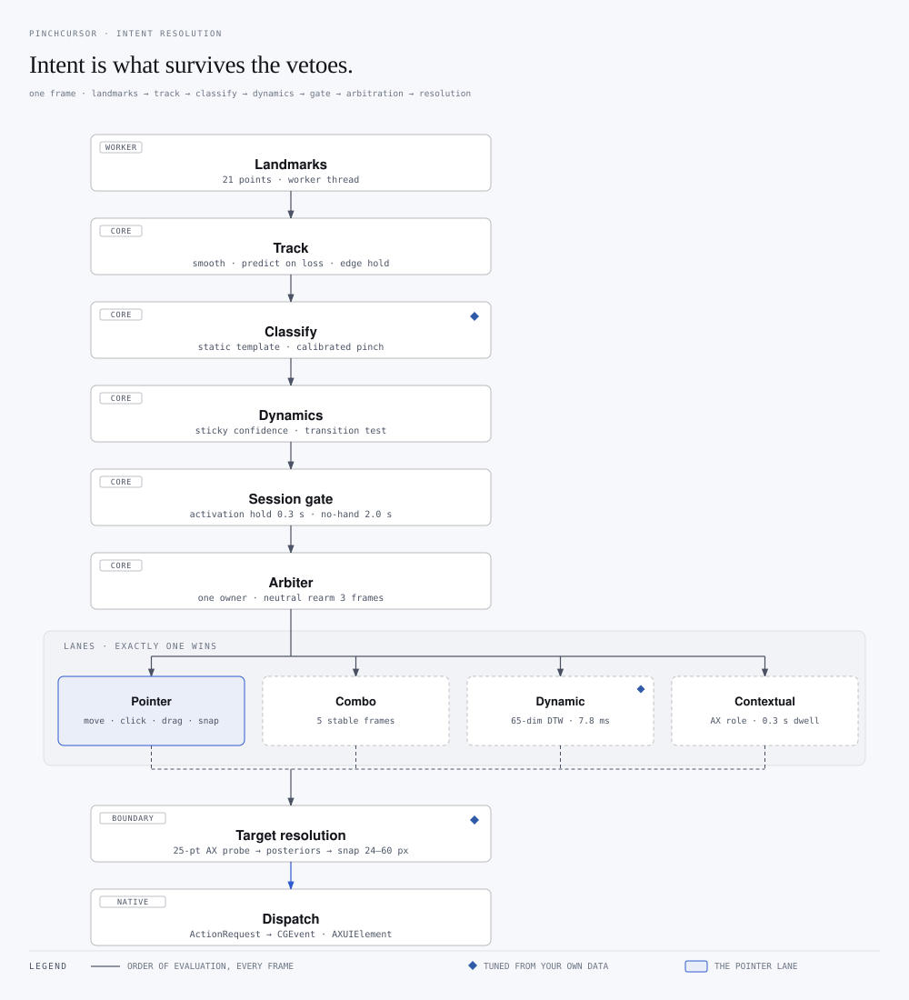
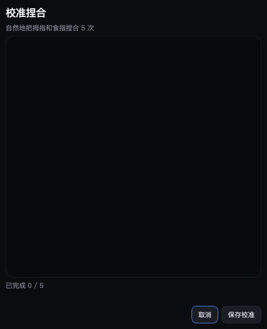
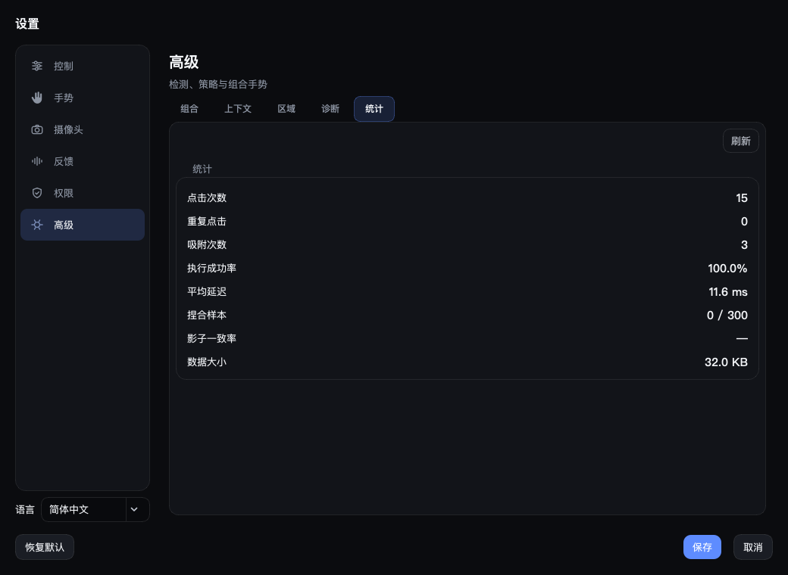

# PinchCursor

**Turn your Mac into a touchless workstation.** PinchCursor reads your hand from the built‑in camera and drives the pointer — move, click, drag, scroll, run shortcuts — while keeping every decision deterministic, local, and reversible.

<p align="center">
  
</p>

<p align="center">
  
  
  
  
  
</p>

<p align="center">
  
</p>

> **中文简介** — PinchCursor 是一套 macOS 手势输入系统：摄像头识别 21 个手部关键点，用确定性的状态机驱动指针、点击、拖动与滚动。它的重点不是"炫技"，而是把延迟、误触、隐私和可回退性当成第一等公民：核心指针通道永远由状态机独占，机器学习只做建议，全部数据留在本机。

---

## Why another gesture app?

Most gesture demos die at the same three places: the cursor jitters, a fist closing to an exit gesture fires a phantom click, and nobody can tell whether the thing is learning anything. PinchCursor is built around those failures instead of around the demo:

- **Deterministic pointer lane.** Move / click / drag are owned by a state machine. A learned model may *rank candidates*, never emit input.
- **Transition guards.** A fist closes *through* the pinch shape; a causal 200 ms motion window tells a real pinch from a pass‑through, so the click never fires on the way out.
- **Target‑aware clicks.** At the moment you pinch, the accessibility tree supplies the buttons around your cursor; a Bayesian scorer snaps the 24 px you were off — and refuses when two candidates are equally likely.
- **Feels like a tool, not a toy.** Two resource profiles, a local event log with a hard size ceiling, per‑user pinch calibration, and a full revert path for every feature.

## Features

| | |
|---|---|
| **Pointer control** | 21‑landmark hand tracking → cursor movement, left/right/double click, drag, four‑way scroll, custom shortcuts (13 native actions on macOS) |
| **Two mapping modes** | *Absolute* (hand position = screen position) or *relative* with a gain and automatic re‑anchoring — relative mode needs half the arm travel |
| **Multi‑display aware** | The pointer maps onto the union of every attached display, including displays with negative origins |
| **Aiming assist** | Bayesian target scoring from the accessibility tree; 24 px snap ceiling, ambiguity rejection, optional learned ranker |
| **Gesture grammar** | Static poses with hysteresis, user‑recorded dynamic motions (DTW with a trajectory channel), two‑stage combos, custom trigger poses |
| **Context‑aware** | Gestures and actions can be gated by the accessibility category under the pointer (clickable, slider, text input, scrollable) |
| **Two performance profiles** | *Standard*: 640×480 on CPU. *Performance*: 1280×720 on the Metal GPU — measured **faster per frame** than standard |
| **Privacy first** | Camera frames never leave memory. The optional event log stores geometry and outcomes only — no images, no text, no window titles — capped at ~2 MB and 30 days |
| **Bilingual UI** | Full Chinese and English catalogues, switchable at runtime |

## How it works



Two threads, one lane that owns the pointer. Camera capture and MediaPipe inference run on a worker thread, so a slow frame can never stall the cursor; classification, arbitration and the pointer state machine run deterministically on the main thread; `platform_services/` is the only place `ctypes` touches macOS, which is why the fake-backed tests can drive the whole pipeline without a camera or an accessibility grant.

The core (`core/`) is pure Python with no Qt imports, so every decision layer is unit‑testable; the shell (`gui/`) is PySide6; `platform_services/` hides macOS Accessibility and CGEvent behind contracts with a fake‑backed implementation for tests.

### Intent, in detail



Every stage on that spine is a veto, and the vetoes compound. A hand that reads as a pinch but closes all four fingers is downgraded to a point; a point that has not held the activation gesture for 300 ms never reaches the state machine; a click whose best candidate cannot clear a 0.55 posterior is refused rather than guessed — two identical targets side by side split the probability mass and both fail.

| Stage | What it reads | What it rejects |
|---|---|---|
| **Track** | smoothed position, time since last sighting | a cursor that jumps while the hand is out of frame |
| **Classify** | 21 landmarks, thumb–index ratio against your calibrated thresholds | hands at a distance where the ratio means nothing |
| **Dynamics** | pinch confidence, closing rate of the other three fingers | the classic false pinch — a whole hand closing |
| **Session gate** | activation gesture held 0.3 s, 2.0 s grace after loss | idle hands resting in view |
| **Arbiter** | which lane held the hand last, neutral for 3 frames | a combo and a pointer gesture claiming the same frame |
| **Lanes** | 5 stable frames, DTW distance, 0.3 s dwell | sequences that never completed |
| **Target resolution** | softmax over accessibility candidates, 0.55 floor, 24–60 px snap | ambiguous neighbours and unreachable targets |

Recorded motions are the one lane that is taught rather than inferred: a trajectory is stored as a 65-dimensional sequence, optionally bound to an accessibility category ("only in scrollable areas"), and matched with DTW against your own templates. Ten prototypes over a 180-frame take cost 7.8 ms — once per completed motion, not per frame.

### Measured on an Apple M5 Max

| | Standard (640×480 CPU) | Performance (1280×720 Metal) |
|---|---|---|
| Inference / frame | 5.18 ms | **4.06 ms** |
| Steady‑state CPU | ≈16 % of one core | lower — the work leaves the CPU |
| Target probe (per click) | 3.9 ms | 3.9 ms |
| Dynamic gesture match | 7.8 ms / 10 templates | same |

Numbers are from `time.perf_counter` loops in this repository, not from a spec sheet.

## Install

Requires macOS 15+, Python 3.13, and a camera.

```bash
git clone https://github.com/<you>/pinchcursor.git
cd pinchcursor
python3.13 -m venv .venv
.venv/bin/pip install -r requirements.txt
.venv/bin/python main.py
```

Build a standalone `.app` (PyInstaller cannot cross‑compile, so run it on macOS):

```bash
./scripts/build_macos_app.sh
open "dist/PinchCursor.app"
```

### Permissions

macOS gates the interesting parts. Grant **Camera** (to see your hand) and **Accessibility** (to move the pointer and read the UI). Input Monitoring is only needed if you use the hold‑to‑activate shortcut. Rebuilding the app with an ad‑hoc signature resets these grants — expect to re‑approve once.

## Using it

1. Pick a camera in **Settings → Camera**.
2. Choose how control activates: a hand gesture (default: open palm), a hold‑to‑talk style shortcut, either, or always.
3. Press **Start**. Show your palm to take control, move, and pinch to click. A fist ends the session.
4. Open **Settings → Control → Calibrate pinch** once; it learns your own pinch amplitude so the threshold survives a new camera or a different seat.
5. Optional: turn on **Usage data** (local only) and later train the candidate ranker with `scripts/train_target_ranker.py` — see below.

<p align="center">
  
</p>

<p align="center">
  
</p>

## Privacy

- Frames live in memory and are overwritten every frame. Nothing is recorded.
- The optional event log (`telemetry.sqlite3`) stores gesture names, accessibility roles, geometry, latency and outcomes. It has no column for text, labels, titles, or images, is capped at 20 000 events / 30 days, and **is off by default**.
- "Delete collected data" in settings vacuums the file, not just the rows.

## Learning loop (optional, local)

**There is no online self-learning, and that is deliberate.** A model that retrains on whatever it just saw will learn the user's mistakes, and nothing that moves the pointer is allowed to run without evidence. What the app does adapt to is narrower, and every piece of it is inspectable:

| Mechanism | Trigger | Persists in | What it changes |
|---|---|---|---|
| **Pinch calibration** | five pinches in settings | `settings.json` | the enter/exit ratio thresholds for your hand and camera distance |
| **Recorded motion** | you record one take | `settings.json` (`dynamic_gestures.templates`) | a DTW prototype, optionally bound to an accessibility category |
| **Target ranker** | `scripts/train_target_ranker.py` over your telemetry | `target_ranker.json` | how candidate targets are scored — never whether a click happens |

The ranker is the only learned model, and it runs behind three gates: it refuses to train below 200 labelled locks, it splits by time rather than at random and prints its validation top-1 next to the Bayesian baseline, and it can start in **shadow** mode, where it logs whether it agrees with the deterministic scorer without touching the pointer. Promotion to `ranker` mode is a setting you change, not something the app decides.

```
normal use ─▶ candidates table (features + labels) ─▶ train_target_ranker.py
                                                              │
                      settings: Bayesian ◀── shadow ──▶ learned ranker
```

```bash
.venv/bin/python scripts/train_target_ranker.py --db ~/path/to/telemetry.sqlite3
```

<p align="center">
  
</p>

## Tests

```bash
env -u PYTHONPATH QT_QPA_PLATFORM=offscreen .venv/bin/python -m pytest -q
# 647 passed
```

The suite covers the native adapters with fake bindings, the decision layers with synthetic landmarks, the QSS wiring, and the packaging contracts. macOS input itself is exercised by hand — see `docs/VALIDATION.md`.

## Status & limits

- **macOS is the supported platform.** A Windows adapter exists behind the same contracts but has only been tested with fake bindings; treat it as experimental.
- **It is a second input device, not a mouse replacement.** 60–120 ms end‑to‑end latency and monocular tracking are fine for pointing at large targets, presenting, or working without touching the machine — not for pixel‑level design work.
- **Accessibility coverage varies.** Native controls expose geometry; Electron and web content often do not, so aiming assist simply does not engage there.
- **The learned ranker is new.** It trains on your own usage; until you have a few hundred labelled locks, the Bayesian scorer is the better answer.

## Topics

`macos` · `gesture-control` · `hand-tracking` · `mediapipe` · `pyside6` · `accessibility` · `computer-vision` · `dtw` · `privacy` · `desktop-automation` · `python` · `human-computer-interaction`

## Roadmap

- [x] Deterministic pointer lane with arbitration and session gating
- [x] Target‑aware snapping with ambiguity rejection
- [x] Relative mapping, multi‑display union, pinch calibration
- [x] Trajectory channel for recorded motions
- [x] Local telemetry + candidate ranker training pipeline
- [ ] Windows hardware validation
- [ ] Learned transition classifier for pinch vs. pass‑through
- [ ] On‑device calibration of the motion thresholds from real recordings

## License

AGPL‑3.0. See [LICENSE](LICENSE).

Copyright (C) 2026 CYK16688.

Built on [MediaPipe](https://developers.google.com/edge/mediapipe/solutions/vision/hand_landmarker) hand landmarks and [PySide6](https://doc.qt.io/qtforpython/). The 1€ filter follows Casiez, Roussel & Vogel (CHI 2012); the target scorer follows Bi & Zhai's Bayesian Touch (UIST 2013).
