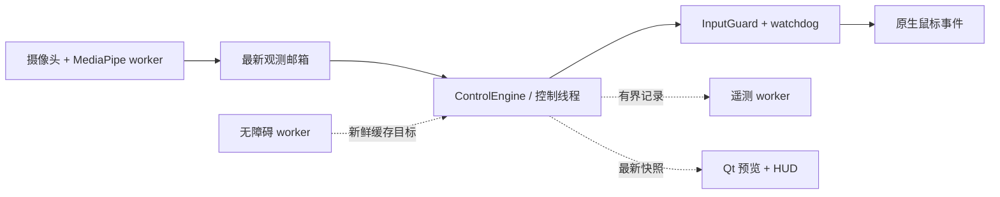

# PinchCursor

[English](README.md) | [简体中文](README.zh-CN.md)

**把 Mac 变成无需接触的工作站。** PinchCursor 通过内置摄像头读取手部动作并驱动鼠标指针，支持移动、点击、拖动、滚动和快捷键，同时保证每个输入决策都确定、本地且可回退。

<p align="center">
  
</p>

<p align="center">
  
  
  
  
  
</p>

<p align="center">
  
</p>

> PinchCursor 是一套 macOS 手势输入系统：摄像头识别 21 个手部关键点，由确定性的状态机驱动指针、点击、拖动与滚动。项目优先解决延迟、误触、隐私和可回退性：核心指针通道始终由状态机独占，机器学习只负责给出建议，全部数据都留在本机。

---

## 为什么还需要一款手势应用？

大多数手势演示都倒在同一个地方：指针抖动；握拳结束会话时误触发点击；系统是否在学习、学到了什么也无法判断。PinchCursor 直接围绕这些失败点设计：

- **确定性指针通道。** 移动、点击和拖动由状态机控制。学习模型最多只能给候选结果排序，不能直接产生输入。
- **过渡保护。** 握拳时会经过捏合形状；系统通过 200 ms 的因果运动窗口区分真实捏合与穿过的短暂姿态，因此结束会话时不会产生幽灵点击。
- **目标感知点击。** 捏合发生时，无障碍树会提供指针附近的按钮；贝叶斯评分器可在 24 px 内修正误差，当两个候选同样可信时则拒绝猜测。
- **真正可用的工具。** 提供两档资源模式、带硬性容量上限的本地事件日志、按用户校准的捏合阈值，以及每个功能的完整回退路径。

## 功能

| | |
|---|---|
| **指针控制** | 21 个手部关键点 → 指针移动、左/右键、双击、拖动、四向滚动和自定义快捷键（macOS 支持 13 个原生动作） |
| **两种映射模式** | *绝对映射*（手部位置对应屏幕位置）或带增益和自动重锚的*相对映射*；相对模式只需约一半的手臂移动范围 |
| **多显示器支持** | 指针可映射到所有已连接显示器的联合区域，包括原点为负坐标的显示器 |
| **瞄准辅助** | 基于无障碍树进行贝叶斯目标评分；吸附近似上限为 24 px，支持歧义拒绝和可选的学习排序器 |
| **手势语法** | 带迟滞的静态姿势、用户录制的动态动作（带轨迹通道的 DTW）、两阶段组合手势和自定义触发姿势 |
| **上下文感知** | 可根据指针下的无障碍类别（可点击、滑块、文本输入、可滚动区域）限制手势和动作 |
| **两档性能模式** | *标准*模式：CPU 上运行 640×480。*性能*模式：Metal GPU 上运行 1280×720，单帧实测**快于标准模式** |
| **隐私优先** | 摄像头画面不会离开内存。可选事件日志只保存几何和结果，不记录图像、文本或窗口标题，上限约为 2 MB、30 天 |
| **中英双语界面** | 完整中文和英文界面目录，可在运行时切换 |

## 工作原理



摄像头采集和 MediaPipe 推理通过单槽邮箱直接把结果提交给独立的控制线程。`ControlEngine` 负责分类、时序仲裁和动作生命周期，GUI 只负责渲染快照。独立的输入 watchdog 会在 250 ms 后让摄像头证据过期；即使 GUI 停止处理事件，它也会尝试释放仍被按下的鼠标按键。原生事件的发送和释放严格串行。停止时先撤销会话，再等待 worker，因此尚未处理完的帧无法重新启动输入。无障碍查询和遥测都采用有界后台队列，不会阻塞控制线程。详见[运行时契约](docs/CONTROL_ARCHITECTURE.md)。

点击许可与点击定位共享同一个连续手势片段，包括可信的张开指向、收缩、闭合确认和释放。闭合前的手指尖会随手掌平移，并用短时数值滤波历史重建瞄准轨迹，从而排除手指卷曲造成的位移。在候选尚未确认时，可见指针继续跟随手指尖，另一条分支单独保存重建后的目标位置。确认后会锁定该目标；拖动则由手掌平移单独控制。候选取消后，安全的张开指向可以恢复指针移动，不会过早重新进入可点击状态。明确的张开动作会释放按键；证据不确定时取消交互。稳定的指向状态可以转为持续捏住拇指的滚动操作，瞄准位置保持固定，也不依赖无障碍目标发现。浮点观测会保留到原生输入发送前，持续的小幅修正可以穿过静止抖动死区并最终稳定下来。

决策引擎及其运行时是不依赖 Qt 的 Python 模块。摄像头 worker 和 GUI 外壳使用 PySide6；`platform_services/` 通过接口隔离 macOS Accessibility 和 CGEvent，并提供测试用假实现。

### 意图识别细节


运动证据、激活状态和通道所有权共同决定输入是否能够继续。整只手闭合、孤立的捏合闪烁和不一致的跟踪都会取消点击候选。在“手势激活”模式下，必须先保持激活姿势，控制才会开始。目标辅助是可选项：如果没有任何候选达到置信度阈值，重建出的瞄准位置仍然会作为点击目标。

| 阶段 | 读取的信息 | 拒绝的情况 |
|---|---|---|
| **跟踪** | 平滑后的位置、距上次看到手部的时间 | 手离开画面时指针突然跳动 |
| **分类** | 21 个关键点、归一化后的拇指与食指距离 | 距离过远、比例失去意义的手部 |
| **动态** | 捏合置信度、其余三根手指的闭合速率 | 典型的假捏合：整只手一起闭合 |
| **会话门控** | 激活姿势保持 0.3 秒；手部丢失后有 2.0 秒宽限期 | 停留在画面中的闲置手部 |
| **仲裁器** | 上一条控制手势的通道；连续 3 帧的中立状态 | 组合手势与指针手势同时争用同一帧 |
| **捏合/瞄准联合判断** | 可信张开姿势、收缩历史、明确闭合、手掌传递后的指尖位置和物理时序 | 孤立闭合、手指卷曲导致的目标漂移、只有卷曲的拖动和不完整手势片段 |
| **手势通道** | 连续 5 个稳定帧、DTW 距离、0.3 秒停留 | 从未完整结束的动作序列 |
| **目标解析** | 无障碍候选的 softmax、0.55 置信度下限、24–60 px 吸附范围 | 相邻目标存在歧义或目标不可达 |

录制动作是唯一需要用户示范的手势通道：轨迹会保存为 65 维序列，可绑定无障碍类别（例如只在可滚动区域生效），并通过 DTW 与用户自己的模板匹配。对 180 帧的录制，使用 10 个原型进行一次完整动作匹配耗时 7.8 ms；该计算只在动作完成后执行一次，不是逐帧执行。

### 在 Apple M5 Max 上的测量

| | 标准模式（640×480，CPU） | 性能模式（1280×720，Metal） |
|---|---|---|
| 单帧推理 | 5.18 ms | **4.06 ms** |
| 稳态 CPU | 约占单核 16% | 更低，主要工作由 GPU 分担 |
| 单次点击目标探测 | 3.9 ms | 3.9 ms |
| 动态手势匹配 | 7.8 ms / 10 个模板 | 相同 |

以上数据来自本仓库中的 `time.perf_counter` 测量，并非硬件规格表数据。

## 安装

需要 macOS 15+、Python 3.13 和摄像头。

```bash
git clone https://github.com/CYK16688/PinchCursor.git
cd PinchCursor
python3.13 -m venv .venv
.venv/bin/pip install -r requirements.txt
.venv/bin/python main.py
```

运行状态（`settings.json`、可选事件日志和单实例锁）保存在 `~/Library/Application Support/PinchCursor/`，不会写入应用包。应用包内写入会破坏签名，并在下次构建时丢失设置。如果首次启动时发现旧版本在应用包内留下的设置文件，会自动迁移到新位置。

构建独立 `.app`（PyInstaller 不支持交叉编译，因此必须在 macOS 上运行）：

```bash
./scripts/build_macos_app.sh
open "dist/PinchCursor.app"
```

构建脚本会自动查找钥匙串中的 `Developer ID Application` 证书并用于签名。稳定的 Developer ID 签名会把应用的指定要求固定为 **Bundle ID + Team ID**，因此 Camera、Accessibility 和 Input Monitoring 授权可以跨后续构建保留。没有证书时脚本会退回 ad-hoc 签名；它的指定要求基于二进制哈希，每次构建都像一款新应用。更麻烦的是，macOS 可能仍在“系统设置”中显示旧开关为**开启**，却拒绝当前进程，单从界面很难判断。

```bash
./scripts/build_macos_app.sh                                     # 自动检测
CODESIGN_IDENTITY="Developer ID Application: ..." ./scripts/...   # 明确指定
```

无论采用哪种签名方式，应用都需要在 **“系统设置 → 隐私与安全性”** 中授予三项权限：Camera、Accessibility（移动指针、发送点击）和 Input Monitoring（读取按住激活快捷键）。Accessibility 和 Input Monitoring 权限只有在应用退出并重新打开后才会生效。如果授权是在签名发生变化前做出的，应重置旧记录，而不是反复开关：执行 `tccutil reset Accessibility com.cyk16688.pinchcursor`，Camera 权限同理。

构建过程结束时还有一道发布检查：如果 `Contents/` 中混入了任何运行状态（`settings.json`、事件日志或锁文件），或者 `codesign --verify --strict` 失败，构建会直接失败，而不是生成一个看似可用的坏包。否则，下次启动会被 Gatekeeper 拒绝，绑定到签名的所有 TCC 授权也会丢失。

### 权限

macOS 会对关键能力进行权限控制。请授予 **Camera**（读取手部）和 **Accessibility**（移动指针、读取 UI）。只有使用按住激活快捷键时才需要 **Input Monitoring**。使用 ad-hoc 签名重新构建应用会重置这些授权，因此每轮构建可能需要重新批准一次。

## 使用

1. 在 **设置 → 摄像头** 中选择摄像头。
2. 选择控制激活方式：手势（默认张开手掌）、类似按住说话的快捷键、两者均可，或始终启用。
3. 点击 **开始**。张开手掌接管控制，移动手部来移动指针，捏合执行点击；握拳结束会话。
4. 第一次使用时打开 **设置 → 控制 → 校准捏合**，让系统学习你的捏合幅度，在不同摄像头或座位下仍能保持有效阈值。
5. 可选：在本地开启 **使用数据**，稍后使用 `scripts/train_target_ranker.py` 训练候选排序器，详见下文。

<p align="center">
  
</p>

<p align="center">
  
</p>

## 隐私

- 摄像头帧只存在于内存中，并会被下一帧覆盖，不会录制。
- 可选事件日志（`telemetry.sqlite3`）只保存手势名称、无障碍角色、几何、延迟和结果；没有记录文本、标签、窗口标题或图像的字段，上限为 20,000 条事件 / 30 天，**默认关闭**。
- 设置中的“删除已收集数据”会 vacuum 整个数据库文件，而不只是删除表内记录。

## 学习回路（可选、仅本地）

**本项目不做在线自学习，这是刻意设计。** 如果模型直接根据刚刚看到的数据重新训练，它也会学会用户的错误；任何能移动指针的模型都必须在证据支持下才能运行。系统只进行范围很窄、且可检查的本地适配：

| 机制 | 触发条件 | 保存位置 | 调整内容 |
|---|---|---|---|
| **捏合校准** | 在设置中完成五次捏合 | `settings.json` | 针对当前手部和摄像头距离的进入/退出阈值 |
| **录制动作** | 用户主动录制一次动作 | `settings.json`（`dynamic_gestures.templates`） | 一个 DTW 原型，可选绑定无障碍类别 |
| **目标排序器** | 用遥测数据运行 `scripts/train_target_ranker.py` | `target_ranker.json` | 候选目标的排序方式；绝不决定是否点击 |
| **瞄准辅助** | 开启使用统计后，每次启动 | `settings.json`（`pointer_assist.learned`） | 吸附半径和置信度下限，范围有界且必须有证据 |
| **捏合边界模型** | 开启使用统计后，每次捏合 | `telemetry.sqlite3`（`transitions`），之后是 `transition_model.json` | 捏合是否出于真实意图；**目前只做影子评分**，不会参与决策 |

瞄准辅助使用应用能够记录的最直接、可靠的信号：用户在 1.5 秒内不得不重做的点击。当重做率超过 20% 时，最多把吸附半径缩小 15%，并把置信度下限提高 0.03；经过一百次干净点击后，会略微放宽下限。它绝不会超过用户配置的吸附范围；用户编辑该值时会丢弃自动学习到的调整，以用户设置为准。

捏合边界模型使用一种标记技巧：过渡保护丢弃一次捏合时不会产生点击，因此本没有明确标签；唯一的用户反对信号是“坚持再试”，即这次捏合被丢弃后，手在 0.5 秒内重新回到捏合姿势。系统会将该事件保留 0.55 秒再写入，避免把重试前的短暂动作误判为标签。`scripts/train_transition.py` 会使用六个运动特征拟合逻辑边界，并且只有在按时间分割的留出集上优于原规则时才写入模型。在此之前，模型评分只会和规则决策一起记录，不会被用于输入。

目标排序器是唯一可以实际参与动作的学习模型，并且必须通过三道门槛：少于 200 个带标签的点击锁定事件时拒绝训练；训练集按时间切分而非随机切分；训练后打印验证集 top-1 和贝叶斯基线。它还可以先以 **shadow** 模式运行，仅记录是否与确定性评分器一致，不触碰指针。只有用户手动将设置切换到 `ranker` 模式后，排序器才能参与实际点击定位。

```text
日常使用 ─▶ 候选表（特征 + 标签） ─▶ train_target_ranker.py
                                                     │
              设置：贝叶斯 ◀── shadow ──▶ 学习排序器
```

```bash
.venv/bin/python scripts/train_target_ranker.py --db ~/path/to/telemetry.sqlite3
```

训练前可以先查看日志是否积累了足够数据：

```bash
.venv/bin/python scripts/learning_status.py --db ~/path/to/telemetry.sqlite3
# pinch episodes   42 / 300
#   acted+retried  28 (need 60)
#   dropped        14 (need 60)
# shadow agreement 100.0% over 42 scored episodes
# ready to train   no  — waiting on: episodes, positives, negatives
```

同样的统计也会显示在 **设置 → 高级 → 统计信息** 中，无需打开终端即可观察数据积累情况。`ready to train yes` 来自训练脚本自身的门槛判断，并非另一套独立估算。

<p align="center">
  
</p>

## 测试

```bash
env -u PYTHONPATH QT_QPA_PLATFORM=offscreen .venv/bin/python -m pytest -q
# 1353 passed
```

测试覆盖使用假绑定的原生适配器、使用合成关键点的决策层、QSS 连接和打包约定。macOS 原生输入仍需要人工验证，详见[验证文档](docs/VALIDATION.md)。

## 状态与限制

- **macOS 是正式支持的平台。** 同一套接口下也提供 Windows 适配器，但目前只用假绑定测试过，应视为实验性功能。
- **目标是稳定替代鼠标，真实使用验收尚未完成。**
  完整的 landmark 回放已经覆盖 15/30/60 FPS 下的点击、双击、移动拖动与释放，也覆盖依赖坐标的连续滚动、手部丢失和过期帧。这些测试使用假的原生输入。
  联合点击/瞄准回放会与独立生成的张开手指轨迹比较，覆盖移动中的突然/渐进闭合、屏幕边缘、相对映射、候选拒绝后的恢复以及摄像头几何变化。
  合成精细控制测试覆盖持续的单点修正和屏幕边缘到达，但不能证明真实摄像头下的准确度或舒适度。端到端延迟、小目标选择、文本选择和长时间使用仍需与实体鼠标对比。仅测量推理时间不等于输入延迟。
- **无障碍覆盖并不一致。** 原生控件通常能提供几何信息；Electron 和网页内容经常无法提供，因此这些场景不会启用瞄准辅助。
- **学习排序器仍处于早期阶段。** 它使用用户自己的数据训练；在积累几百次带标签的点击锁定事件之前，贝叶斯评分器通常更适合实际使用。

## 关键词

`macos` · `gesture-control` · `hand-tracking` · `mediapipe` · `pyside6` · `accessibility` · `computer-vision` · `dtw` · `privacy` · `desktop-automation` · `python` · `human-computer-interaction`

## 路线图

- [x] 带仲裁和会话门控的确定性指针通道
- [x] 带歧义拒绝的目标感知吸附
- [x] 相对映射、多显示器联合区域和捏合校准
- [x] 录制动作的轨迹通道
- [x] 本地遥测与候选排序器训练流程
- [ ] Windows 硬件验证
- [x] 事件片段记录、离线训练器和捏合边界影子评分
- [ ] 在留出数据上超过规则后，启用学习到的捏合边界
- [ ] 根据真实录制数据在设备上校准动作阈值

## 许可证

AGPL-3.0，详见 [LICENSE](LICENSE)。

Copyright (C) 2026 CYK16688.

基于 [MediaPipe](https://developers.google.com/edge/mediapipe/solutions/vision/hand_landmarker) 手部关键点和 [PySide6](https://doc.qt.io/qtforpython/)。1€ 滤波参考 Casiez、Roussel 与 Vogel（CHI 2012）；目标评分参考 Bi 与 Zhai 的 Bayesian Touch（UIST 2013）。
