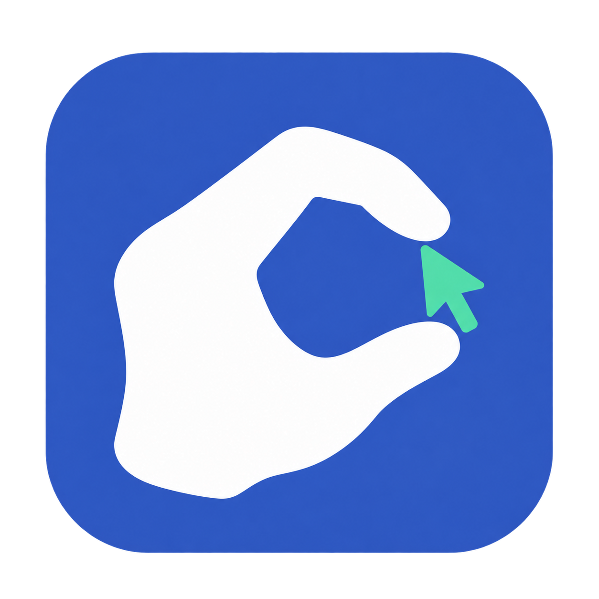
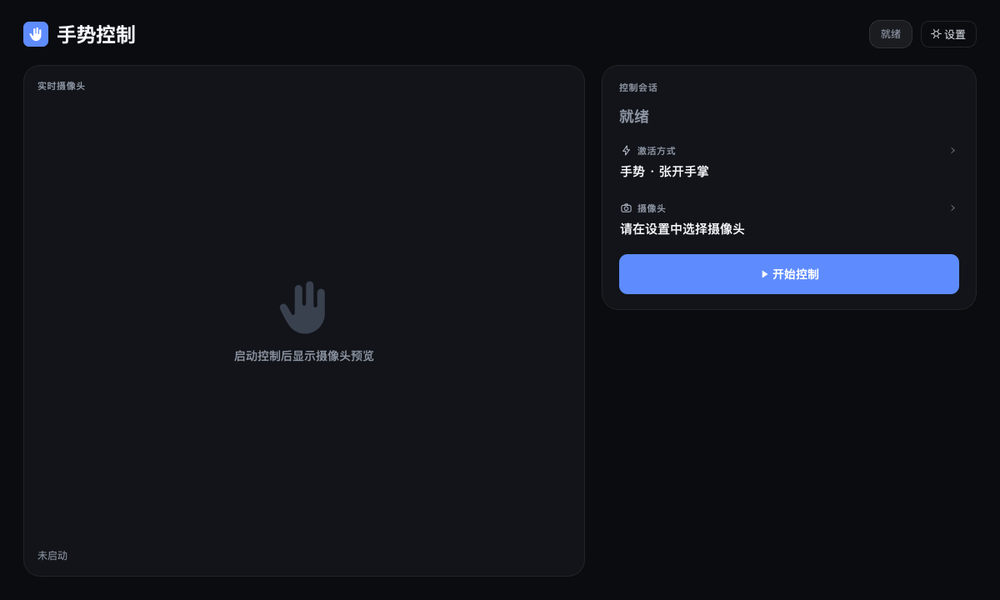
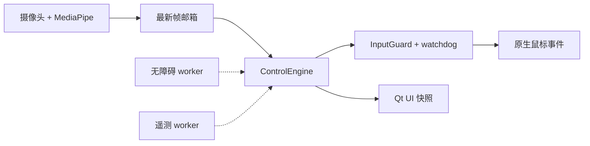
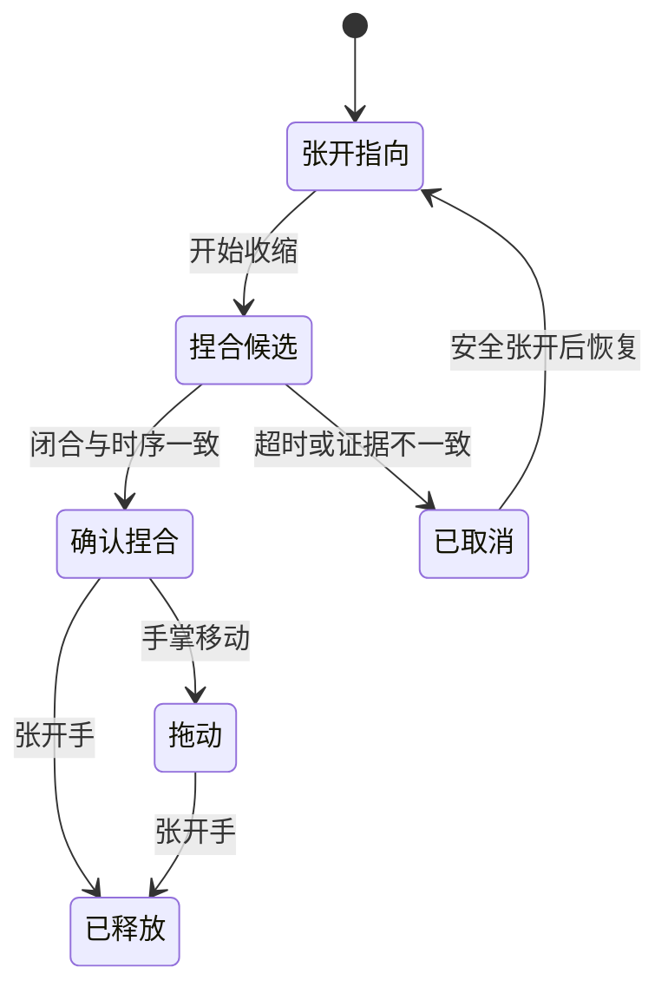
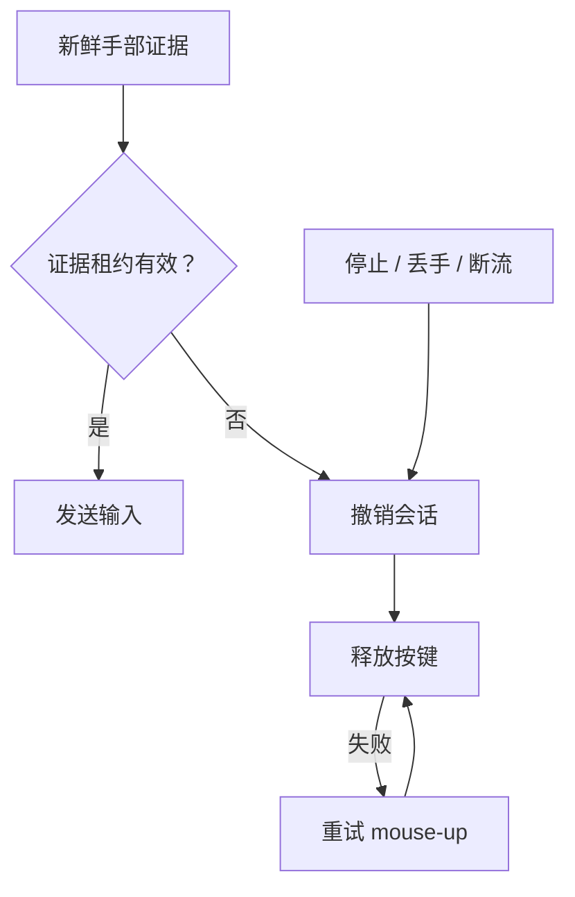
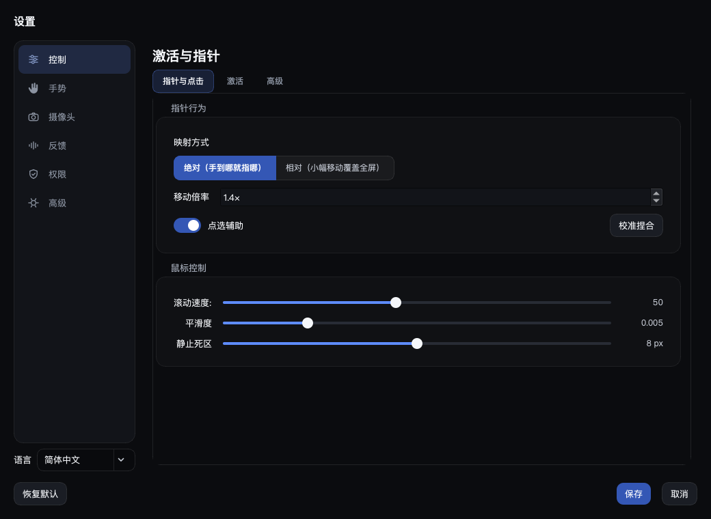

# PinchCursor

[English](README.md) | [简体中文](README.zh-CN.md)

**用连续手势控制 Mac。** PinchCursor 将摄像头手部追踪转换为指针移动、点击、拖动和滚动；意图判断保持确定性、本地运行，并且随时可以中断。

相关检索词：摄像头鼠标、虚拟鼠标、隔空鼠标、手势鼠标、捏合点击、MediaPipe 手部追踪。

<p align="center">
  
</p>

<p align="center">
  
  
  
  
  
</p>

<p align="center">
  
</p>

## 能做什么

| | |
|---|---|
| **指针** | 使用 21 个手部关键点控制移动、单击、双击、拖动和滚动 |
| **意图** | 将张开指向、手指收缩、闭合时序和最终释放整合为一次连续捏合 |
| **定位** | 重建闭合前的点击目标，避免手指继续移动把点击带偏 |
| **安全** | 在张开、丢失手部、过期画面、摄像头断流和应用停止时释放按键 |
| **控制** | 绝对/相对映射、多显示器、精细控制、个性化校准和自定义手势 |
| **隐私** | 摄像头画面只留在内存；本地诊断默认关闭且有容量上限 |

## 工作原理



摄像头处理和 MediaPipe 推理独立于 UI 运行。唯一的控制线程负责滤波、意图、指针状态与原生输入；无障碍和遥测使用有界后台队列，即使上下文查询或磁盘写入变慢，也不会阻塞指针移动。

## 连续意图



候选阶段中，可见指针仍跟随指尖，另一条分支保存重建后的瞄准位置。只有连续证据确认捏合后，系统才锁定该位置并点击。拖动随后由手掌平移控制，因此单纯卷曲手指不会带偏点击或自行开始拖动。

## 断流与安全释放



Watchdog 使用 250 ms 证据租约，并在释放失败时持续重试。旧帧无法重新激活已撤销的会话，尚未完成的 mouse-up 也会阻止新的按下。以上是软件策略，原生 API 自身卡死的情况仍需在真机验收。

## 安装

需要 macOS 15+、Python 3.13 和摄像头。

```bash
git clone https://github.com/CYK16688/PinchCursor.git
cd PinchCursor
python3.13 -m venv .venv
.venv/bin/pip install -r requirements.txt
.venv/bin/python main.py
```

运行状态保存在 `~/Library/Application Support/PinchCursor/`，不会写入应用包。

构建并启动应用：

```bash
./scripts/build_macos_app.sh
open "dist/PinchCursor.app"
```

在 **系统设置 → 隐私与安全性** 中授予 **Camera** 和 **Accessibility**。只有使用按住激活快捷键时才需要 **Input Monitoring**。稳定的 `Developer ID Application` 签名可让授权跨重新构建保留；没有证书时构建会退回 ad-hoc 签名。

## 使用

1. 在 **设置** 中选择摄像头和激活方式。
2. 点击 **开始**，张开手掌接管指针，移动手部并通过捏合点击。
3. 张开手掌释放；握拳结束会话。
4. 首次使用时运行 **设置 → 控制 → 校准捏合**，适配自己的手部和摄像头距离。

<p align="center">
  
</p>

## 隐私与学习

摄像头画面不会离开内存。可选事件日志只保存手势结果和几何数据，不记录图像、文本或窗口标题，默认关闭并设有容量上限。

捏合校准、录制手势和可选目标排序都在本地适配。唯一能够影响指针输入的学习模型是目标排序器，并且默认以影子模式运行，必须由用户明确启用。阈值和回退方式见[运行时契约](docs/CONTROL_ARCHITECTURE.md)。

## 验证

```bash
env -u PYTHONPATH QT_QPA_PLATFORM=offscreen .venv/bin/python -m pytest -q
# 1353 passed
```

合成关键点回放覆盖点击、双击、拖动、释放、滚动、丢手、过期帧、摄像头几何变化、精细控制以及 15/30/60 FPS 链路。原生输入使用假 OS 接收端。真实摄像头准确度、实体鼠标等价性、实际拔插恢复和长时间舒适度仍需设备验收，详见[验证文档](docs/VALIDATION.md)。

## 生态与相关项目

PinchCursor 是面向 macOS 的实现，重点是连续捏合意图、闭合前点击定位和受 watchdog 保护的原生输入。以下项目属于基础依赖、相关实践或索引；建立引用不代表兼容、背书或功能等价。

| 项目 | 关联 |
|---|---|
| [MediaPipe](https://github.com/google-ai-edge/mediapipe) · 约 3.74 万 Star | 运行时使用的手部关键点推理框架 |
| [OpenCV](https://github.com/opencv/opencv) · 约 9.14 万 Star | 摄像头采集和图像处理基础 |
| [PyObjC](https://github.com/ronaldoussoren/pyobjc) · 约 827 Star | macOS 无障碍与原生事件桥接 |
| [Barehands](https://github.com/jaredrhod/barehands) · 约 1.1k Star | 相似的摄像头手部控制界面 |
| [Gesture-Controlled-Virtual-Mouse](https://github.com/Viral-Doshi/Gesture-Controlled-Virtual-Mouse) · 约 878 Star | 使用 Python/MediaPipe 的虚拟鼠标实践 |
| [hand-gesture-recognition-using-mediapipe](https://github.com/Kazuhito00/hand-gesture-recognition-using-mediapipe) · 约 770 Star | 基于手部关键点的手势分类参考 |
| [awesome-hands-control](https://github.com/RylanBot/awesome-hands-control) · 约 350 Star | 手势控制软件资源索引 |
| [NonMouse](https://github.com/takeyamayuki/NonMouse) · 约 202 Star | 面向桌面使用的摄像头手势鼠标 |

Star 数为约数，核对于 2026-10-29。

## 状态

- macOS 为正式支持平台；Windows 适配器仍为实验性。
- 无障碍瞄准更适合原生控件，在 Electron 或网页内容中可能不会启用。
- 学习排序器通常需要数百个带标签的点击后才具备使用价值。

## 许可证

AGPL-3.0，详见 [LICENSE](LICENSE)。

基于 [MediaPipe](https://developers.google.com/edge/mediapipe/solutions/vision/hand_landmarker) 和 [PySide6](https://doc.qt.io/qtforpython/).
